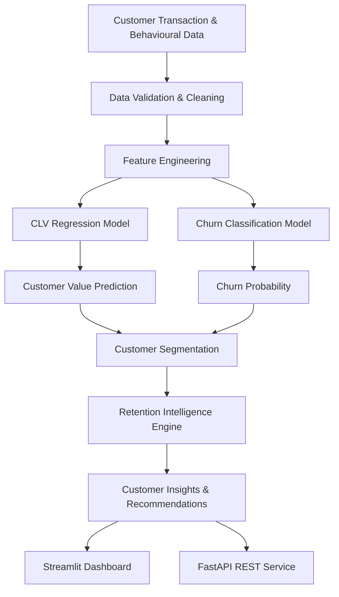

# AI-Based Customer Lifetime Value Prediction and Retention Intelligence System

**Predict Customer Value. Identify Churn Risk. Drive Smarter Retention Strategies.**

## Project Overview

An end-to-end customer analytics system designed to predict Customer Lifetime Value (CLV), identify potential customer churn, analyse behavioural patterns, and support targeted customer retention strategies using Machine Learning and Data Analytics. The system integrates customer value prediction, churn risk classification, and behavioural segmentation to understand customer purchasing patterns and identify opportunities for improved customer engagement and retention. It leverages machine learning algorithms, including regression models, classification techniques, and K-Means clustering, to estimate future customer value, assess churn probability, and group customers based on their behavioural characteristics.

An interactive **Streamlit dashboard** and **FastAPI-based REST API** provide capabilities for customer analytics, predictive insights, customer profiling, and intelligent retention recommendations.

## Key Objectives

- Predict customer lifetime value using historical purchasing behaviour.
- Identify customers with a high probability of churn.
- Analyse customer purchasing patterns and engagement.
- Segment customers based on behavioural and monetary characteristics.
- Develop targeted retention strategies using predictive insights.
- Support data-driven customer relationship management decisions.

## Key Capabilities

| Feature | Description |
|---|---|
| Customer Lifetime Value Prediction | Estimate future customer value using historical behavioural and transactional data. |
| Churn Risk Prediction | Identify customers who are likely to become inactive. |
| Customer Segmentation | Group customers using K-Means clustering. |
| RFM Analysis | Analyse Recency, Frequency, and Monetary value. |
| Retention Intelligence | Generate rule-based customer retention recommendations. |
| Behavioural Analytics | Examine customer purchasing and engagement patterns. |
| Explainable Insights | Provide important model features and human-readable reason codes. |
| Interactive Dashboard | Explore customer KPIs, CLV distributions, churn risk, and customer segments. |
| REST API | Serve customer-level predictions through FastAPI. |

## System Architecture

The system follows an integrated customer analytics workflow, combining data preprocessing, predictive modelling, behavioural segmentation, and retention intelligence.



## Machine Learning Architecture

The system integrates multiple machine learning approaches to analyse customer value, churn behaviour, and customer segments.

### Customer Lifetime Value Prediction

A regression-based approach estimates future customer value using historical transaction and behavioural features.

### Churn Risk Prediction

A classification-based approach estimates the probability of customer churn using purchasing patterns, engagement, tenure, and customer activity.

### Customer Segmentation

K-Means clustering groups customers based on scaled behavioural and monetary features to identify distinct customer segments.

### Retention Intelligence

A transparent rule-based recommendation engine combines predicted CLV, churn probability, and customer segments to generate targeted retention suggestions.

## Customer Intelligence Indicators

The system analyses multiple customer-level indicators:

- Recency – Days since the last purchase.
- Frequency – Number of customer transactions.
- Monetary Value – Total customer spending.
- Tenure – Duration of the customer relationship.
- Average Order Value – Average spending per transaction.
- Support Tickets – Number of customer support interactions.
- Engagement Score – Measure of customer engagement.

These indicators support customer profiling, behavioural analysis, value estimation, and churn risk assessment.

## Technology Stack

| Category | Technologies |
|---|---|
| Programming | Python |
| Data Processing | Pandas, NumPy |
| Machine Learning | Scikit-learn |
| Predictive Analytics | Regression and Classification Models |
| Customer Segmentation | K-Means Clustering |
| Statistical Analysis | RFM Analysis |
| Visualization | Matplotlib |
| Dashboard | Streamlit |
| Backend | FastAPI, Uvicorn |
| Model Management | Joblib |
| Testing | Pytest |
| Development | Jupyter Notebook, VS Code |
| Version Control | Git, GitHub |

## Methodology

1. **Data Generation & Collection** – Generate or load customer-level transactional and behavioural data.
2. **Data Preprocessing** – Validate data types, handle missing values, and check data ranges.
3. **Exploratory Data Analysis** – Examine customer distributions, purchasing behaviour, and engagement patterns.
4. **Feature Engineering** – Develop RFM, tenure, average order value, and engagement features.
5. **CLV Prediction** – Train regression models to estimate customer lifetime value.
6. **Churn Prediction** – Develop classification models to estimate customer churn probability.
7. **Customer Segmentation** – Apply K-Means clustering to identify behavioural customer groups.
8. **Retention Intelligence** – Generate customer-specific retention recommendations.
9. **Model Evaluation** – Assess predictive performance using appropriate evaluation metrics.
10. **Dashboard & API Integration** – Present customer intelligence through an interactive dashboard and REST API.

## Model Evaluation

The system evaluates predictive performance using appropriate regression and classification metrics.

### CLV Regression Metrics

| Metric | Purpose |
|---|---|
| MAE | Measures average absolute prediction error. |
| RMSE | Penalizes larger prediction errors. |
| R² Score | Measures the proportion of variance explained by the model. |

### Churn Classification Metrics

| Metric | Purpose |
|---|---|
| Accuracy | Overall classification correctness. |
| Precision | Proportion of predicted churn cases that are actual churn cases. |
| Recall | Proportion of actual churn cases correctly identified. |
| F1-Score | Balance between precision and recall. |
| ROC-AUC | Measures classification ranking performance. |
| Confusion Matrix | Evaluates correct and incorrect classifications. |

*Model performance should be established using properly separated validation and test datasets. Synthetic-data results should not be interpreted as proof of real-world predictive effectiveness.*

## API Usage – Customer Intelligence & Prediction

The FastAPI service provides a `/predict` endpoint that accepts customer behavioural, transactional, and engagement information through a POST request.

### Key Input Parameters

- **Recency:** Days since the customer's last purchase.
- **Frequency:** Number of customer transactions.
- **Monetary Value:** Total customer spending.
- **Tenure:** Duration of the customer relationship.
- **Average Order Value:** Average spending per transaction.
- **Support Tickets:** Number of customer support interactions.
- **Engagement Score:** Customer engagement level.

### Expected API Outputs

- Predicted Customer Lifetime Value.
- Customer churn probability.
- Customer risk classification.
- Customer segment identification.
- Retention recommendations.

## Installation & Quick Start

**1. Clone the repository**

```bash
git clone <your-repository-url>
cd <repository-folder>
```

**2. Create a virtual environment**

```bash
python -m venv venv
```

**3. Activate the environment**

Windows:

```bash
venv\Scripts\activate
```

Linux / macOS:

```bash
source venv/bin/activate
```

**4. Install dependencies**

```bash
pip install -r requirements.txt
```

**5. Generate sample customer data**

```bash
python scripts/generate_data.py
```

**6. Execute the analytics pipeline**

```bash
python scripts/run_pipeline.py
```

**7. Launch the Streamlit dashboard**

```bash
streamlit run dashboard/app.py
```

**8. Start the FastAPI backend**

```bash
uvicorn api.main:app --reload
```

API documentation:

`http://127.0.0.1:8000/docs`

*Ensure the commands and application paths match the actual repository implementation.*

## Repository Structure

```text
Customer_Analytics/
├── api/
│   └── main.py
├── config/
│   └── config.yaml
├── data/
│   ├── processed/
│   └── sample/
│       └── customers.csv
├── docs/
│   ├── 01_project_overview.md
│   ├── 02_problem_statement.md
│   ├── 03_objectives_and_scope.md
│   ├── 04_literature_and_concepts.md
│   ├── 05_system_architecture.md
│   ├── 06_methodology.md
│   ├── 07_dataset_dictionary.md
│   ├── 08_feature_engineering.md
│   ├── 09_clv_prediction.md
│   ├── 10_churn_prediction.md
│   ├── 11_customer_segmentation.md
│   ├── 12_retention_intelligence.md
│   ├── 13_model_evaluation.md
│   ├── 14_dashboard_guide.md
│   ├── 15_api_guide.md
│   ├── 16_testing.md
│   ├── 17_deployment.md
│   ├── 18_privacy_and_responsible_use.md
│   ├── 19_limitations_and_future_work.md
│   └── 20_references.md
├── notebooks/
│   ├── 01_customer_eda.ipynb
│   ├── 02_feature_engineering.ipynb
│   ├── 03_clv_modeling.ipynb
│   ├── 04_churn_modeling.ipynb
│   └── 05_customer_segmentation.ipynb
├── scripts/
│   ├── generate_data.py
│   └── run_pipeline.py
├── src/
│   └── customer_analytics/
│       ├── __init__.py
│       ├── data.py
│       ├── features.py
│       ├── models.py
│       ├── segmentation.py
│       ├── retention.py
│       └── pipeline.py
├── tests/
│   ├── test_features.py
│   └── test_retention.py
├── dashboard/
│   └── app.py
├── .env.example
├── .gitignore
├── LICENSE
├── requirements.txt
└── pyproject.toml
```

## Future Enhancements & Roadmap

- Implement advanced time-aware and probabilistic CLV prediction.
- Introduce uplift modelling to estimate the incremental impact of retention campaigns.
- Integrate CRM and e-commerce data through authorized data connectors.
- Implement model monitoring, drift detection, and automated retraining.
- Integrate SHAP-based model explainability.
- Develop customer campaign performance and A/B testing analytics.
- Expand customer segmentation using advanced clustering techniques.
- Introduce scalable database integration and cloud deployment.

## Responsible Use & Limitations

- Use synthetic, public, or explicitly authorized customer data.
- Do not upload confidential customer or transactional information to public repositories.
- Validate models for bias and monitor prediction drift.
- Avoid using sensitive personal attributes or proxies for unfair customer treatment.
- Protect personal information and obtain appropriate consent.
- Treat predictive scores as decision-support indicators rather than definitive judgments about customers.

## Author

**Mohamed Riyaz S.**  
Integrated M.Tech – Computer Science and Engineering (Business Analytics)  
Vellore Institute of Technology (VIT), Chennai
